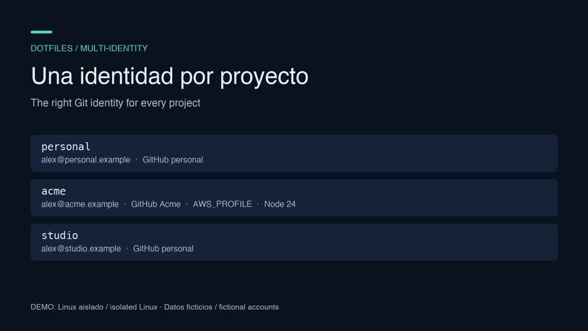

# Dotfiles multi-identidad

[English](README.md)

**Una computadora, varias cuentas de GitHub, cero confusiones, ninguna contraseña en texto plano.**

Si tienes una cuenta personal de GitHub y además trabajas para una o varias empresas, seguramente ya hiciste
commit con el email equivocado, push con la llave SSH equivocada, o dejaste una API key en un archivo `.env`.
Este repo configura tu computadora para que **la identidad correcta se active sola al entrar a una carpeta**:

```
~/code/personal/mi-blog     →  tu@personal.example, tu llave SSH y tu sesión de GitHub personales
~/code/acme/backend         →  tu@acme.com, la llave SSH y la sesión de GitHub de Acme, las API keys de Acme
cualquier otro lugar        →  git se niega a commitear hasta que estés en el lugar correcto
```

Tus contraseñas, tokens y llaves SSH privadas **se quedan en tu gestor de contraseñas** (1Password o Bitwarden).
En disco solo se escriben *referencias* a ellos, así que nada secreto termina en texto plano en este repo ni en tu carpeta personal.

> Los archivos de configuración, sus comentarios y el wizard están en inglés; esta traducción cubre la documentación.

## Qué obtienes

- **El nombre, email y firma de git correctos** en cada carpeta, y también en clones y worktrees fuera de esas
  carpetas, reconocidos por la URL del remote.
- **La llave SSH correcta** para cada cuenta de GitHub (o Bitbucket, o GitLab), aunque tengas varias cuentas en el mismo sitio.
- **La sesión de `gh` correcta** por cuenta.
- **API keys que se cargan al entrar a una carpeta y desaparecen al salir** (Linear, Jira, Sentry, Stripe,
  Datadog, Expo, Claude Code… o las tuyas). Nunca se guardan en texto plano.
- **Commits firmados** ("Verified" en GitHub) con llaves que nunca salen de tu gestor de contraseñas.
- Un **asistente de configuración** (wizard) que hace unas cuantas preguntas y se encarga del resto, en macOS, Linux, WSL y Windows (PowerShell).

## Mira el wizard en acción

[](https://github.com/coffeerv/dotfiles-public/releases/tag/tutorial-2026-10-19)

[Descarga el tutorial — español, inglés o ambas pistas de audio](https://github.com/coffeerv/dotfiles-public/releases/tag/tutorial-2026-10-19) (4:43, 1080p).
Grabado en un contenedor Linux aislado, con identidades ficticias y narración generada con IA.
[Guiones, subtítulos e instrucciones de producción](docs/screencast/README.md).

## Inicio rápido

Unos 10 minutos. Cambia `~/.gitconfig`, `~/.ssh/config` y el perfil de tu terminal (`~/.zshrc`, o tu perfil de
PowerShell en Windows). Si ya tienes esos archivos, el wizard guarda una copia de respaldo antes de reemplazarlos.

Necesitas:
- un gestor de contraseñas: **1Password** o **Bitwarden**, con su app de escritorio y su **agente SSH** activado. Es un
  ayudante integrado que deja a otros programas usar tus llaves SSH sin verlas nunca; ver el [Glosario](#glosario).
  Cómo activarlo: [1Password](https://developer.1password.com/docs/ssh/get-started/#step-3-turn-on-the-1password-ssh-agent),
  [Bitwarden](https://bitwarden.com/help/ssh-agent/).
- **git**
- en Windows: **PowerShell 7** (`winget install Microsoft.PowerShell`)

Luego:

1. **Haz tu propia copia** de este repo en GitHub (Fork, o "Use this template"). Conviene que sea **privada**:
   va a contener tus emails y tus llaves *públicas*. No son secretos, pero sí son datos personales.
2. **Instala [mise](https://mise.jdx.dev)**, que instala todas las demás herramientas por ti:
   - macOS / Linux / WSL: `curl https://mise.run | sh`
   - Windows: `winget install jdx.mise`
3. **Descarga tu copia** (esto todavía no cambia nada):
   ```sh
   mise use -g chezmoi
   chezmoi init https://github.com/<tu-usuario>/<tu-copia>.git
   ```
4. **Corre el wizard:**
   ```sh
   cd "$(chezmoi source-path)"
   mise trust
   mise run setup
   ```
5. **Sigue los "Next steps"** que imprime al final: agregar tus llaves a GitHub, iniciar sesión en `gh` y guardar tus API keys en tu gestor de contraseñas.

Nada en tu carpeta personal cambia hasta que confirmas: el wizard primero te muestra un resumen y la lista de archivos,
y puedes detenerlo en cualquier momento con Ctrl-C. (Las llaves SSH que crea en 1Password se quedan ahí; si lo vuelves a correr, las reutiliza.)

¿Usas lector de pantalla, o prefieres preguntas simples en vez de menús? Corre `mise run setup -- --plain`.

**¿Ya tienes tus propios alias o ajustes?** Ponlos en `~/.zshrc.local`, `~/.gitconfig.local` o `~/.ssh/config.local`
(Windows: `~/profile.local.ps1`). Se cargan automáticamente y el setup nunca los toca.

### ¿Principiante o avanzado?

El wizard lo pregunta al inicio.

- **Principiante** cubre lo esencial:
  - tu nombre
  - tu cuenta personal de GitHub y tu email (puede usar la dirección privada no-reply de GitHub)
  - tus cuentas de trabajo
  - qué API keys necesita cada cuenta
  - una llave SSH por cuenta, que puede crearte en 1Password
- **Avanzado** agrega:
  - otra carpeta de proyectos (en vez de `~/code`)
  - más hosts de git por cuenta (Bitbucket, GitLab, self-hosted), cada uno con su propia llave
  - secretos propios además de la lista incluida
  - variables de entorno (como `AWS_PROFILE`)
  - versiones de herramientas por cuenta (como `node` o `ruby`)

## Cómo funciona, en un minuto

Cuando haces `cd ~/code/acme/backend`:

1. **git** reconoce la carpeta (o la URL del remote) y carga la configuración de Acme: tu email de Acme, qué llave SSH
   usar y con qué llave firmar tus commits. La llave en sí vive en el agente SSH de tu gestor de contraseñas, que firma
   cuando git se lo pide.
2. **mise** aplica la configuración no secreta de Acme, como qué sesión de `gh` usar, y las versiones de herramientas que Acme necesite.
3. **fnox** carga las API keys de Acme en tu terminal. Las lee de una pequeña caché **cifrada** en tu máquina,
   así que es instantáneo y nunca te pide contraseña. Al salir de la carpeta, desaparecen.

Cuando rotes un token en tu gestor de contraseñas, corre `secrets-sync` (o `secrets-sync acme`) para refrescar esa caché.

## En el día a día

| Quiero… | Corre |
|---|---|
| refrescar API keys después de cambiarlas en el gestor | `secrets-sync` |
| agregar, editar o quitar una cuenta, o rehacer llaves SSH | `cd "$(chezmoi source-path)" && mise run setup` (te pregunta qué quieres hacer) |
| ver de nuevo la lista de pasos finales | `mise run setup -- --next-steps` |
| ver qué cambiaría antes de aplicar | `chezmoi diff` |
| configurar una computadora nueva | pasos 2–4 del inicio rápido (tus respuestas ya están en tu copia) |
| ver qué identidad usa un repo | `git config user.email` |

## Por dentro

Funciona sobre tres herramientas pequeñas, todas instaladas por mise:
- [chezmoi](https://www.chezmoi.io) escribe los archivos de configuración.
- [mise](https://mise.jdx.dev) define versiones de herramientas y configuración por carpeta.
- [fnox](https://fnox.jdx.dev) maneja los secretos por carpeta, leídos de tu gestor de contraseñas.

<details>
<summary><b>Qué cambia y dónde</b></summary>

Con los datos de ejemplo de este repo:

| Carpeta | Email + llave de firma | Llave SSH para git | Cuenta de `gh` | Secretos en el entorno |
|---|---|---|---|---|
| `~/code/personal/` | personal | `id_personal` | personal | personal |
| `~/code/org1/` | org1 | `id_org1` (GitHub) / `id_org1_bitbucket` (Bitbucket) | org1 | org1 |
| `~/code/org2/` | org2 | `id_org2` | personal (compartida) | org2 |
| cualquier otro lugar | **ninguno: git se niega a commitear** | la del agente | la default | ninguno |

- **Identidad de git:** `~/.gitconfig` usa `includeIf` por **carpeta** y también por **URL del remote**
  (`hasconfig:remote.*.url`, git ≥ 2.36), así que funciona también en worktrees y en clones dentro de `/tmp`.
  Con `user.useConfigOnly`, git falla en vez de adivinar.
- **Llave SSH:** el `core.sshCommand` de cada identidad pasa `-i ~/.ssh/id_<id>.pub -o IdentitiesOnly=yes`. El `.pub`
  solo le dice al agente *qué* llave privada ofrecer, para que dos cuentas en el mismo host no choquen.
- **Firma:** firmas SSH a través del agente del gestor (`op-ssh-sign` con 1Password, `ssh-keygen` con Bitwarden).
  `~/.ssh/allowed_signers` incluye todas las identidades, así que `git log --show-signature` las verifica todas.
- **Secretos:** cada `~/code/<id>/fnox.toml` lista referencias (`op://Vault/Item/campo`, o `Item/campo` con Bitwarden).
  `fnox activate` las carga al hacer `cd`. Los valores salen de `fnox.local.toml`, una caché cifrada con age que
  llena `secrets-sync`, y los secretos marcados con `env = false` solo están disponibles con `fnox get`.
- **Lo no secreto:** cada `~/code/<id>/mise.toml` tiene `GH_CONFIG_DIR`, variables extra y versiones de herramientas.
  Para tus propios agregados usa `mise.local.toml`, que el setup nunca toca.
</details>

<details>
<summary><b>Estructura del repo</b></summary>

```
.chezmoidata/user.toml         tus respuestas: nombre, emails, cuentas, llaves PÚBLICAS (lo escribe el wizard; editarlo a mano está bien)
.chezmoidata/services.toml     la lista de servicios incluidos y los secretos que necesita cada uno
.chezmoitemplates/             las plantillas compartidas con las que se genera cada identidad
dot_gitconfig.tmpl             reglas includeIf, generadas para cada identidad y host
dot_gitconfig.os.tmpl          el único archivo con rutas propias del sistema (programa de firma, ssh/ssh.exe, helper de gh)
dot_gitconfig-<id>*.tmpl       stubs de una línea por identidad (el wizard los crea y borra)
private_dot_ssh/               config del agente, id_<id>.pub, allowed_signers
code/<id>/                     stubs de mise.toml + fnox.toml por identidad
dot_zshrc.tmpl                 zsh: activación de mise + fnox, secrets-sync
Documents/PowerShell/          lo mismo para PowerShell 7 en Windows
setup/wizard.ts                el wizard (Bun + gum, se corre con `mise run setup`)
tests/identities.sh            genera los datos de ejemplo y verifica qué identidad aplica (CI lo corre en los 3 sistemas)
examples/                      extras que puedes copiar, como un renovador de tokens OAuth de corta vida
```

¿Editaste `user.toml` a mano? Corre `mise run setup -- --sync` para regenerar los stubs y luego `chezmoi apply`.
¿Configuras muchas máquinas? `mise run setup -- --answers mis-respuestas.toml --yes` corre sin preguntas.
</details>

<details>
<summary><b>Gestores de contraseñas</b></summary>

| | 1Password | Bitwarden |
|---|---|---|
| Secretos (fnox) | provider `op` | provider `bitwarden` (necesita `BW_SESSION`; `secrets-sync` lo desbloquea por ti) |
| Agente SSH | agente de 1Password | agente de Bitwarden (en Windows, desactiva el servicio "OpenSSH Authentication Agent") |
| Firma de commits | `op-ssh-sign` | `ssh-keygen` a través del agente |
| El wizard puede crear llaves SSH | sí | no: crea la llave en la app de escritorio y pega su llave pública |
| Nombres de items | vault → item → campo | `"<prefijo> <item>"` con un campo personalizado |

Para cambiar después, modifica `password_manager` en `.chezmoidata/user.toml` (o vuelve a correr el wizard) y aplica.
fnox soporta [muchos otros backends](https://fnox.jdx.dev). Agregar uno implica tocar `.chezmoitemplates/secret-ref`,
la plantilla de config de fnox y `secrets_unlock`.
</details>

<details>
<summary><b>Plataformas y estado del proyecto</b></summary>

- **macOS, Linux, WSL:** zsh, con `~/.ssh/config` apuntando al socket del agente. En WSL, el agente de Windows se alcanza con `ssh.exe`.
- **Windows:** perfil de PowerShell 7, `ssh.exe` y named pipes, `gitdir/i` para rutas sin distinción de mayúsculas.

Estado: CI genera la configuración y verifica qué identidad aplica en macOS, Linux y Windows. El uso de punta a punta
(llaves reales, pushes reales) es lo que menos se ha probado con Bitwarden, WSL y Windows nativo. Se agradecen issues y correcciones.
</details>

## Qué está y qué no está en este repo

**Sí está (público, no secreto):** nombres, emails, nombres de cuentas/orgs, llaves SSH *públicas* y *referencias* como `op://Acme/Linear/api-key`.

**Nunca está:** llaves privadas, tokens, contraseñas, `fnox.local.toml` (la caché cifrada), `~/.config/fnox/age.txt`
(la llave de esta máquina para esa caché), sesiones de `gh`. `.gitignore` bloquea los sospechosos habituales como red de seguridad.

## Glosario

- **Llave SSH:** un par de llaves que le demuestra a GitHub quién eres. La mitad privada se queda en tu gestor; la pública se comparte.
- **Agente SSH:** un programa, aquí parte de tu gestor de contraseñas, que usa tus llaves privadas cuando se le pide, sin exponerlas.
- **Firma de commits:** una firma en cada commit que demuestra que lo hiciste tú. GitHub la muestra como "Verified".
- **chezmoi / mise / fnox:** ver [Por dentro](#por-dentro).

## Soporte

Esto es un ejemplo para copiar y adaptar, tal cual (as-is). Los issues y pull requests son bienvenidos, pero puede que no reciban respuesta.

## Licencia

[MIT](LICENSE)
